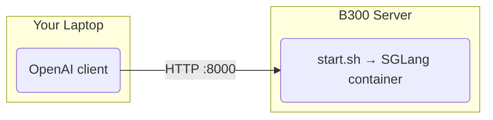

# GLM-5.3-Flash on SGLang (8x B300)

One-command SGLang deployment of [zai-org/GLM-5.3-Flash](https://huggingface.co/zai-org/GLM-5.3-Flash), serving an OpenAI-compatible API.

Recipe: [SGLang cookbook: GLM-5.3-Flash](https://docs.sglang.io/cookbook/autoregressive/GLM/GLM-5.3-Flash).

## Architecture



## Server Deployment

Requires Docker + NVIDIA Container Toolkit on the server.

```bash
./install_docker.sh   # one-time; skips anything already installed
cp .env.sample .env   # optional; edit overrides
./start.sh            # streams the boot log, returns once /v1/models answers
./stop.sh
```

First boot downloads ~330GB of FP8 weights into `~/.cache/huggingface` (override with `HF_CACHE`).

### Parallelism

| `GPU_ID` | Layout | Notes |
|----------|--------|-------|
| `0,1,2,3,4,5,6,7` (default) | TP8 | Most KV cache |
| `0,1,2,3` | TP4 | Fits on 4x B300 (~1.15TB) |

Other GPU counts are rejected at start.

### Settings (`.env` or shell env)

| Variable | Default | Description |
|----------|---------|-------------|
| `GPU_ID` | `0,1,2,3,4,5,6,7` | GPUs passed to the container |
| `HOST` / `PORT` | `0.0.0.0` / `8000` | API bind address |
| `IMAGE` | `lmsysorg/sglang:v0.5.22-cu130` | Needs SGLang >= v0.5.20 |
| `MEM_FRACTION` | `0.85` | `--mem-fraction-static` |
| `MTP` | `1` | MTP speculative decoding (EAGLE, 5 steps, 6 draft tokens) |
| `HF_CACHE` | `~/.cache/huggingface` | Host model cache |
| `HF_TOKEN` | unset | Optional (public model) |
| `EXTRA_ARGS` | unset | Extra SGLang flags, appended last |

Blackwell backends: TRT-LLM DSA for prefill and decode, FP8 KV cache, `flashinfer_trtllm` MoE runner.

Thinking: `--reasoning-parser glm45` splits thinking into `reasoning_content`. Tool calling uses `--tool-call-parser glm47`. Send `tools` in the request; no extra flag is needed. Chat clients should pass `clear_thinking: true` in `chat_template_kwargs` (the model card's advice for chat); `reasoning_effort` accepts `low`, `high`, or `max` (default).

Max context per sequence is 1,048,576 tokens. Recommended sampling: `temperature=1.0`, `top_p=0.95`.

## Test

```bash
curl http://localhost:8000/v1/chat/completions -H "Content-Type: application/json" \
  -d '{"model": "glm-5.3-flash", "messages": [{"role": "user", "content": "Who won the world series in 2020?"}]}'
```

## Files

- `install_docker.sh`: installs Docker + NVIDIA Container Toolkit (on the B300 host)
- `start.sh` / `stop.sh`: run and stop the SGLang server (on the B300 host)
- `.env.sample`: optional overrides for `start.sh`
